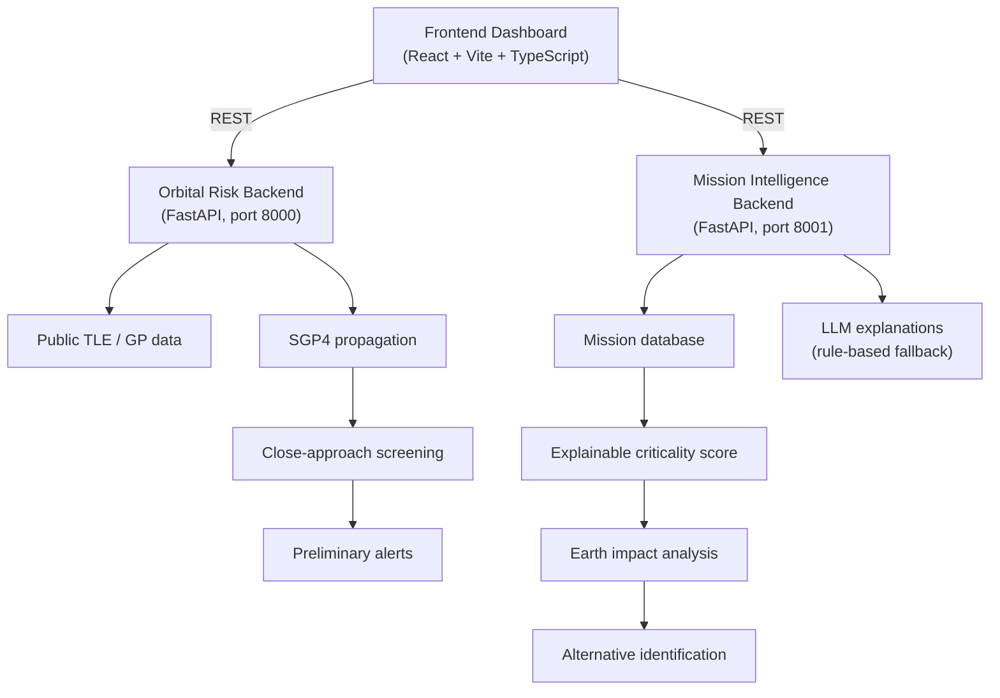

# ASTRAVIGIL

**AI-Powered Orbital Risk Intelligence & Satellite-Service Continuity Platform**

> *Beyond Collision Detection. Protecting What Satellites Make Possible.*

ASTRAVIGIL helps satellite operators understand potential orbital threats, see how important the affected satellite is, estimate which Earth-level services depend on it, and discover possible alternative satellite services.

It is **not** just a satellite tracker or a generic AI chatbot. Its core value is connecting **orbital risk intelligence** with **mission criticality** and **real-world service continuity**.

<!-- Add screenshots here -->
<!--  -->
<!--  -->

---

## Table of contents

1. [Hackathon themes](#hackathon-themes)
2. [The problem](#the-problem)
3. [The three pillars](#the-three-pillars)
4. [Features](#features)
5. [Architecture](#architecture)
6. [Tech stack](#tech-stack)
7. [Repository structure](#repository-structure)
8. [Getting started](#getting-started)
9. [Environment variables](#environment-variables)
10. [API overview](#api-overview)
11. [Mock vs real data](#mock-vs-real-data)
12. [Scientific limits](#scientific-limits)
13. [Roadmap](#roadmap)
14. [Team and workflow](#team-and-workflow)
15. [Business model (proposed)](#business-model-proposed)

---

## Hackathon themes

| Theme | How ASTRAVIGIL addresses it |
|---|---|
| **01: Indian Space Missions & Space Data** | Uses public orbital data and mission information to turn space data into actionable orbital risk intelligence. |
| **03: Space-Based Disaster Management** | Identifies satellites supporting disaster monitoring, shows what is affected if one becomes unavailable, and suggests alternative services. |
| **06: Sustainable Space & Space Environment** | Monitors catalogued debris, screens close approaches, and supports safer long-term orbital operations. |

## The problem

With satellite deployments growing fast, space debris and potential close approaches threaten the safety and sustainability of space operations. Small satellite startups, university CubeSat teams and small operators often lack easy-to-read orbital risk intelligence.

Also, knowing that a close approach exists does not explain **how important the affected satellite is** or **what is lost on Earth if its service stops**. ASTRAVIGIL addresses both.

## The three pillars

### A. Orbital Risk & Space Debris Monitoring
Public TLE/GP data ingestion, SGP4 propagation, preliminary close-approach screening, and orbital data visualisation.

### B. Mission Criticality & Earth Impact Intelligence
Mission identification and classification, an **explainable, rule-based criticality score**, supported Earth services, and AI-generated plain-language explanations.

### C. Satellite Service Continuity
Finds satellites with similar missions, compares sensor, coverage, resolution, revisit time and access, and explains redundancy gaps and limitations.

> Similar mission category does **not** guarantee that one satellite can replace another. Sensor, coverage, resolution, revisit time, availability and access permissions all matter.

## Features

- **Overview:** interactive globe with satellites, debris and flagged close approaches, KPI cards, selected-satellite panel and service-continuity shortcut.
- **Satellite Intelligence:** searchable satellite catalogue, capabilities, orbit data and an explainable mission criticality gauge with its contributing factors.
- **Risk Analysis:** two-dimensional decision matrix. **Physical miss distance** and **mission criticality** are shown as separate axes and never merged.
- **Mission Impact:** criticality scoring, Earth service impact, continuity and redundancy gaps, and an AI operator briefing.
- **Alerts Centre:** triage of flagged close approaches with filters, sorting, investigation status and an incident dossier.
- **Live / Partial / Mock indicator** in the top bar so the data source is always visible.

## Architecture



Design rules:
- The frontend only consumes structured APIs. **No orbital calculations run in the frontend.**
- Mission intelligence is independent of orbital calculations. **Criticality never depends on miss distance, and miss distance never depends on criticality.**
- Satellites are joined across both backends by **NORAD ID**.

## Tech stack

| Layer | Technology |
|---|---|
| Frontend | React, Vite, TypeScript, Tailwind CSS, Lucide icons, charting and globe libraries |
| Backend | Python, FastAPI, Pydantic, NumPy, SGP4 |
| AI | LLM for natural-language explanations; rule-based mission criticality scoring |
| Data | Public TLE/GP orbital data, structured satellite mission dataset |

## Repository structure

```
.
├── frontend/                    # React dashboard (Member 1)
├── backend/
│   ├── orbital_risk/            # SGP4 + close-approach screening API (Member 2)
│   └── mission_intelligence/    # Mission DB, criticality, alternatives, briefing (Member 3)
├── docs/
│   ├── api-contract.md          # Shared API contract (source of truth)
│   ├── RUNNING.md               # Detailed run instructions
│   └── INTEGRATION_GAPS.md      # Known mismatches between UI and APIs
└── README.md
```

## Getting started

### Prerequisites

- Git
- Node.js 18+ and npm
- Python 3.10+
- (Optional) An LLM API key for the mission backend. Without one, explanations fall back to rule-based text.

### 1. Clone

```bash
git clone https://github.com/ritamdeep/ai_orbital_risk_intelligence.git
cd ai_orbital_risk_intelligence
git checkout main
```

### 2. Create environment files

Copy each `.env.example` to `.env` and fill in the values (see [Environment variables](#environment-variables)). **Never commit `.env` files or API keys.**

### 3. Run the orbital backend (port 8000)

```bash
cd backend/orbital_risk
python -m venv .venv

# Windows
.venv\Scripts\activate
# macOS / Linux
# source .venv/bin/activate

pip install -r requirements.txt
uvicorn main:app --port 8000
```

API docs: http://localhost:8000/docs

### 4. Run the mission backend (port 8001)

```bash
cd backend/mission_intelligence
python -m venv .venv
.venv\Scripts\activate        # or: source .venv/bin/activate
pip install -r requirements.txt
uvicorn main:app --port 8001
```

API docs: http://localhost:8001/docs

### 5. Run the frontend

```bash
cd frontend
npm install
npm run dev
```

Open the URL printed in the terminal (Vite's default is http://localhost:5173). The top-bar chip should read **Live** when both backends respond.

> The app module name (`main:app`) may differ. Check each backend's own `README.md` for the exact command.

### Troubleshooting

| Symptom | Likely cause and fix |
|---|---|
| Chip says **Mock** | A backend is not running, or the URLs in `frontend/.env` are wrong. Open both `/docs` pages to check. |
| CORS error in the browser console | Add the frontend's address to `CORS_ORIGINS` in both backend `.env` files. |
| Port already in use | Stop the other process, or change the port and update the frontend `.env` URLs. |
| `Cannot read properties of null (reading 'useRef')` | Duplicate React. In `frontend`, delete `node_modules` and `package-lock.json`, run `npm install` again, and make sure there is no stray `package.json` at the repo root. |
| Changes not showing | Restart `npm run dev` after editing `.env`, and hard-reload the browser. |

## Environment variables

**`frontend/.env`**

| Variable | Example | Purpose |
|---|---|---|
| `VITE_ORBITAL_API_URL` | `http://localhost:8000` | Orbital backend base URL |
| `VITE_MISSION_API_URL` | `http://localhost:8001` | Mission backend base URL |
| `VITE_USE_MOCK` | `false` | Set to `true` to force mock data (offline demos) |

**Backends** (names only; see each `.env.example`)

| Variable | Used by | Purpose |
|---|---|---|
| `CORS_ORIGINS` | both | Allowed frontend origins |
| `LLM_API_KEY` | mission | Optional. Enables LLM-written briefings. Leave empty for rule-based fallback. |

## API overview

Full details and JSON shapes are in [`docs/api-contract.md`](docs/api-contract.md). Every record carries `dataSource: "real" | "mock"`.

**Orbital backend** (`/api/orbital`)

| Endpoint | Description |
|---|---|
| `GET /satellites` | Active satellites and debris |
| `GET /satellites/{noradId}` | One object |
| `GET /conjunctions` | Flagged close approaches (`windowHours`, `maxSeparationKm`) |
| `GET /conjunctions/{eventId}` | One close-approach event |

**Mission backend** (`/api/mission`)

| Endpoint | Description |
|---|---|
| `GET /satellites` | Mission records |
| `GET /satellites/{noradId}/capabilities` | Sensor, resolution, revisit, coverage, access |
| `GET /satellites/{noradId}/criticality` | Score, tier and contributing factors |
| `GET /satellites/{noradId}/alternatives` | Alternative satellites and redundancy gaps |
| `POST /satellites/{noradId}/briefing` | Plain-language operator briefing |

## Mock vs real data

Honest labelling is a project rule.

- Orbital positions and close approaches are computed from **public TLE/GP data** with SGP4 when live data is available. Bundled sample TLEs are labelled **mock**.
- Mission details that are not confirmed from a public source are labelled **mock / illustrative**.
- If a backend is unreachable, the frontend falls back to mock data and the UI shows **"Mock data. Illustrative values."**
- The top-bar chip shows **Live**, **Partial** or **Mock** at all times.

## Scientific limits

1. Preliminary close-approach screening is **not** a validated conjunction assessment.
2. A close approach does **not** automatically mean a collision.
3. ASTRAVIGIL **never invents or displays collision probabilities.** Open TLE data has no covariance information. We report **miss distance** and **relative velocity** only.
4. Public TLE accuracy is roughly 1 to 3 km in LEO, so results are for **triage, not maneuver decisions.**
5. **Mission criticality does not change physical collision probability.** The two dimensions are always assessed and shown separately.
6. Not every debris fragment can be tracked. We distinguish **catalogued** debris from smaller untracked fragments.
7. **AI does not predict collisions.** Orbital mechanics drives the physics. AI supports classification and explanation only.
8. ASTRAVIGIL is a **decision-support tool.** It does not replace operator-grade conjunction assessment (CDMs from official or commercial space-surveillance providers).

## Roadmap

- Upload and use high-precision CDMs with covariance data
- Live hazard feeds (flood and cyclone overlays, IMD triggers) to raise priority for affected ground tracks
- Broader satellite and mission coverage
- Operator accounts, saved watchlists and notifications
- Deployed hosted version

## Team and workflow

| Role | Responsibility | Branch |
|---|---|---|
| **Member 1: Frontend and UI/UX** (Ritam Deep Chowdhury) | React dashboard, globe, risk visualisation, API integration | `feature/frontend-dashboard` |
| **Member 2: Orbital Intelligence** (add name) | TLE/GP processing, SGP4, close-approach screening, orbital API | `feature/orbital-risk` |
| **Member 3: AI & Mission Intelligence** (add name) | Mission database, criticality scoring, alternatives, AI explanations | `feature/mission-intelligence` |

**Git workflow:** each member works on their own branch and in their own folder. Nobody pushes directly to `main`; open a pull request, get it reviewed, then merge. Never force push. Never commit secrets.

## Business model (proposed)

A proposed model, **not validated revenue**:

- **Basic:** orbital monitoring (SaaS subscription)
- **Professional:** mission intelligence and continuity analysis
- **Enterprise:** custom monitoring and analysis

**Primary users:** Indian small-satellite startups, university CubeSat teams and small operators. **Secondary users:** government and institutional space organisations, satellite service providers and disaster-management agencies.

---

<sub>Hackathon edition. Simulated and mock data are clearly labelled throughout the application.</sub>
